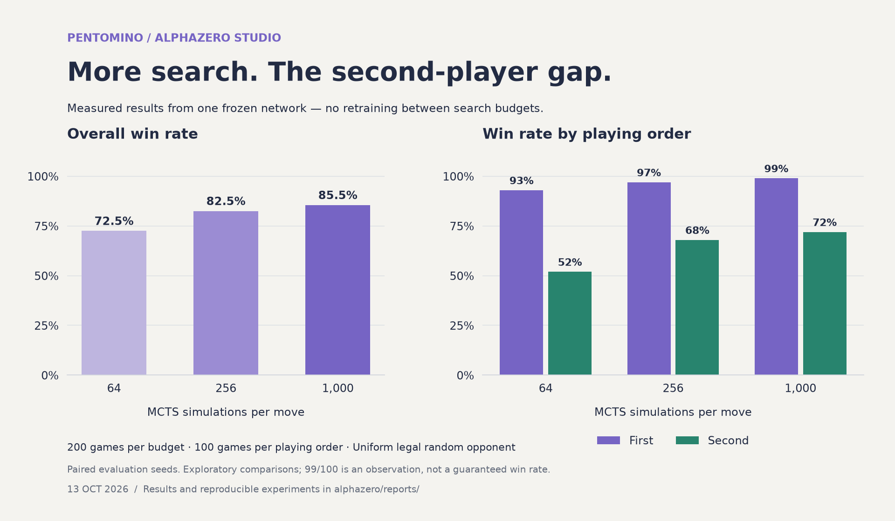

# Pentomino + AlphaZero Studio

Two separate applications in one workspace:

- **Pentomino web game:** React + TypeScript, authoritative room API, persistent Cloudflare D1 rooms. Local two-player mode works without a server database.
- **`alphazero/`:** independent Python package, a reusable game adapter interface, PyTorch policy/value network, PUCT search, self-play training and a local monitoring dashboard.



**Measured, not simulated for illustration.** The same trained network played 200
games against a uniform legal random opponent at each search budget, with paired
seeds and alternating colors. The gain from 256 to 1,000 simulations was only three
percentage points and remains uncertain (exploratory 99% paired interval: −6.5 to
+12.5 points). These results measure search strength, not a training learning curve.
See the [full experiment report](alphazero/reports/diagnosis-20261013.html) and
[machine-readable evidence](alphazero/reports/diagnosis-20261013.json).

The next experiment focuses learning on the **second player's positions**, with
1,000 simulations during self-play. Its configuration and commands are documented
[here](alphazero/README.md#second-player-focused-continuation); no improvement from
that continuation is claimed before evaluation.

## Play locally

```sh
npm install
npm run build
node --import ./scripts/sites-env.mjs ./node_modules/wrangler/bin/wrangler.js d1 execute DB --local --config dist/server/wrangler.json --persist-to .wrangler/state --file drizzle/0000_worried_trauma.sql
npm run dev
```

Apply the database migration once per local database. The development server prints its address (normally `http://127.0.0.1:5173`). Local and hosted room databases are separate.

### Rules

This is an original **two-player territory variant** using the twelve free pentominoes, not a recreation of the classic rectangle-packing puzzle. Each player has one copy of every shape. Violet begins at A1; Lime at L12 on a 12×12 board. Subsequent pieces touch a friendly corner, never a friendly edge. Pieces cannot overlap or leave the board. Opposing pieces may share edges. Rotate with R, reflect with F, select a board square, and confirm placement. A hint searches for a legal move without strategic advice.

Each placed piece earns five points. Passing is permitted only with no legal moves. Two consecutive passes, or both empty inventories, end the game. Highest score wins; ties are draws.

### Multiplayer

Create a room, enter a display name, and share its link or six-character code. Room updates poll every 1.8 seconds. Server-side rules, session-token hashes and revision-checked database updates prevent out-of-turn, forged, and concurrent duplicate moves. A rematch requires both players after the game finishes. Rooms expire after seven days. Seat credentials survive refresh in the same browser tab; closing the session can lose the seat. No account recovery or spectator access is implemented.

Hosted access follows the Site's visibility policy; the initial deployment is private. Allowing friends through hosting access is separate from inviting them into a game room. For deployment outside Sites, use the generated Cloudflare Worker artifact and a D1 database; do not deploy the React files alone and expect multiplayer to work.

## Architecture

```text
app/                    route entry points and global styling
  api/rooms/route.ts     authoritative room operations, auth, persistence, concurrency
components/game/        interactive game UI and piece SVGs
lib/game/
  engine.ts             pure rules, transformations, legal moves, score, transitions
  room-client.ts        typed HTTP transport
 db/schema.ts           persistent room schema
 drizzle/               versioned database migration
 tests/                 rules, room integration and cross-language parity checks
 alphazero/             independent Python learning engine and training studio
```

The browser and server share the same deterministic rules module. The Python adapter is independently optimized with bitboards and tested against the full TypeScript legal-action set across complete games.

## Verification

```sh
node --experimental-strip-types --test tests/engine.test.mjs
npx tsc --noEmit
npm run build
# While the local server is running; creates disposable test rooms:
node --experimental-strip-types tests/rooms.integration.mjs
# From alphazero/ after installing its dependencies:
.venv/bin/python -m pytest -q
```

## Training

See [alphazero/README.md](alphazero/README.md) for setup, scientific assumptions, the game interface, checkpoints and the implementation's differences from the published AlphaZero experiment.
